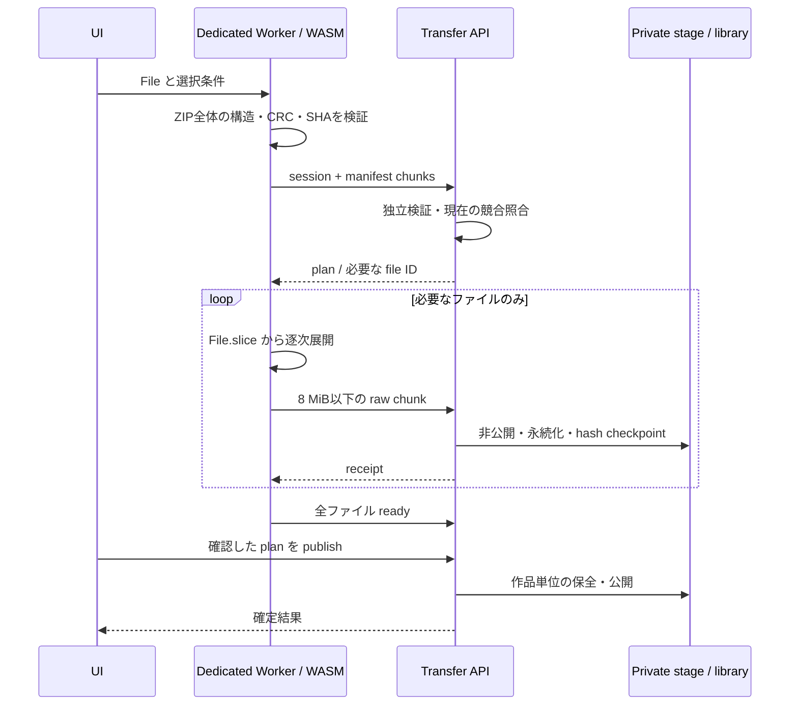

# 小説データ転送のクライアント主体設計

状態: **設計。未実装。** 2026-11-15 の現行コードを調査した結果と、今後実装する契約を分離して記す。
対象は Native / Workers 共通の Web UI による小説データの持ち出し・取り込み。CLI はローカル実行を維持する。
ZIP の中身の仕様は [transfer-archive-format.md](transfer-archive-format.md)。本書は HTTP プロトコル・実行場所・保存境界の再設計である。

## 1. 決定と現状

**クライアントでできる処理はクライアントで行う。** Web の ZIP 生成・展開・CRC/SHA 検証・選択・転送制御をブラウザの Dedicated Worker + WASM へ移す。サーバーは認証、所有するデータの読み出し、受信データの独立検証、保存、競合判定、公開を担当する。

現行の証拠:

| 箇所 | 現行の実態 |
|---|---|
| `src/web/assets/js/ui/transfer.js` の `exportSelectedNovels` | サーバー製 ZIP を NDJSON 内の Base64 から復元する |
| 同 `importNovelArchive` | `Content-Type: application/zip` / `body: file` で ZIP 全体を1回の POST にする |
| `transfer_wasm/src/lib.rs` | `build_zip` / `parse_zip` / `plan_zip` は存在するが、Web UI から呼ばれていない |
| 同 `parse_zip` | 全エントリを検証してメタデータを返す。各ファイルの展開データを JS へ渡す API はない |
| `src/transfer/mod.rs` | ZIP・展開後合計の 512 MiB、単一ファイルの 256 MiB が逐次処理にも共用されている |
| `src/transfer/async_stream.rs` | `force_no_zip64()` がある。サイズ定数の削除だけでは大容量対応にならない |
| `src/native/transfer.rs` / `worker_entry/src/transfer.rs` | ファイルの書き込みと小説レコードの公開は、全体で1つのトランザクションではない |

当初の [v0.5.0-plan.md](v0.5.0-plan.md) が約束したブラウザ WASM 経路は未接続である。「WASM 単体がビルド・テストできる」を Web 機能の完了条件にしてはならない。

今回の2種類の失敗は別の制限である。書き出し中の `raw/...: 展開後サイズが上限` はアプリの展開後合計または単一ファイル上限。取り込みの HTTP 413 はリクエスト本文の拒否で、Cloudflare 前段にも独立した上限がある。報告された 413 の応答本文は未確認なので、その発生元の断定はしない。

## 2. 非交渉の不変条件

1. Web UI は ZIP をサーバーへ送らず、サーバーから ZIP を受け取らない。サーバーで ZIP の圧縮・展開をしない。
2. ネットワークに載せるのは選択したメタデータと必要なファイルのバイト。Base64 本文、巨大 JSON、完成 ZIP / 全展開ファイルの一括 `ArrayBuffer` / `Blob` 化は禁止する。
3. 「必要」は内容を黙って削る意味ではない。完全な書き出しの同梱内容は従来どおり。取り込み先の保存契約で非対応のファイルは、理由と欠落する内容を事前表示し、明示確認なしに落とさない。元のZIPは変更しない。
4. クライアントで検証済みでもサーバーは信用しない。認証、パス、サイズ、実バイトのハッシュ、公開先、既存作品との競合を独立に検査する。
5. 全 ZIP のローカル検証が成功する前に、ファイル本文を送信したり既存作品を変更したりしない。取り込みは必要な全ファイルを準備・検証してから公開を始める。
6. 最小の公開単位は1作品。アーカイブ全体の原子性は約束しない。完了した作品は中断後も残し、失敗した作品の旧内容は保全する。
7. ZIP の大きさ、合計展開サイズ、単一ファイルの大きさを、HTTP のチャンク上限やメモリ予算と混同しない。
8. 中断・応答消失・プロセス死・isolate 交換後も、永続 receipt と journal から結果を判定する。ブラウザの送信済みカウンターは確定の証拠ではない。
9. Native / Workers は同じプロトコルとコア検証を使う。保存方式だけを adapter で分ける。
10. WASM の読込失敗、非対応ブラウザ、旧サーバー時にサーバー ZIP へフォールバックしない。失敗理由を明示する。

## 3. 責務の境界

| 処理 | 実行場所 | 理由 |
|---|---|---|
| ZIP 索引、展開、CRC、ZIP/manifest の照合、正規化 | クライアント WASM | ZIP は端末にあり、サーバーへ運ぶ必要がない |
| ZIP 圧縮、ZIP64、SHA 計算、manifest/central directory 出力 | クライアント WASM | ダウンロード先の端末で完結できる |
| 作品選択、容量表示、確認、進捗、通信・再試行・保存先 | JS / Dedicated Worker | DOM とブラウザ API の境界 |
| Create / Overwrite / Skip の予告 | クライアント | サーバーの照合結果に基づく表示。決定権は持たない |
| 認証、対象ライブラリ、実際の競合と更新世代 | サーバー | クライアントから偽装できてはならない |
| 送受信ファイルの経路・実サイズ・SHA の検証 | 両側 | クライアント破損、通信誤り、偽の申告を検出する |
| スナップショットの保持、受信 stage、容量予約、公開・回復 | サーバー | 保存先を所有する側でしか保証できない |
| 内部保存形式の Brotli codec / D1・SQLite 行への変換 | 保存 adapter | ZIP 処理ではない。ストアの内部形式をブラウザへ漏らさない |

ブラウザに S3 鍵、物理 ObjectKey、D1 ID、native パスを渡さない。バイトの中継は同一 origin の認証済み API で行う。任意の S3 に対する CORS 設定や presigned PUT を必須にしない。

## 4. アーカイブの意味論

- `format_version: 2` を維持し、通常作品の形式 `1` も読む。HTTP の `protocol_version: 2` とは別の版である。
- 同梱規則は `transfer-archive-format.md` を正とする。Worker に保存されていない raw を新たに取得・生成しない。ここでいう履歴は同梱対象の小説配下の cache 等であり、SQLite/D1 の履歴台帳全体を dump する別機能ではない。
- 取り込み先のcapabilitiesはfile policyも返す。Workerのraw HTML保存禁止を維持し、Nativeの完全ZIPにある `raw/` を新規保存しない。ブラウザで除外件数・byte・用途を表示して利用者が確認した投影manifestだけを送る。確認しなければ開始しない。本文・挿絵・設定・旧本文履歴を「キャッシュ」と一括して落とさず、対応不能な必須データがあれば作品を拒否する。現行importとの違いも切替時に告知する。
- 挿絵は prefix の LIST だけで集めない。`.illustration_cache.yaml` と `illustration_key` から共有プールも解決する。画像・APNG は変換せず全バイトを保持する。
- 除外は従来の `backup/`、実行時の lock/tmp、symlink/reparse point 等。秘密の在庫やライブラリルートをクライアント指定で混入できない。
- 上書きはアーカイブにあるファイルだけを置換する。存在しないパスを削除指示と解釈しない。
- ID・保存フォルダ・`vs_<ID>` は取り込み先で決める。ログイン状態、鍵、`original_url` / `raw_title` を転送レコードへ追加しない。
- 部分取り込みを選ぶ場合、全 ZIP の検証後に転送用 manifest を作り直す。選択した親に必要なメンバーを含め、位置と参照を再構成する。未選択のファイルは送らない。
- バーチャル親はメンバーを重複なく同梱し、順序を保持する。通常作品を先に公開し、Skip した既存メンバーも取り込み先 ID へ解決する。欠落・種類不一致・所属競合がある親は公開しない。
- 既存の親の永続 URL を補完する必要がある場合、それは現行どおりサーバーの明示的な CAS 更新である。書き出しを完全な無副作用処理とは記載しない。

### 4.1 通常移行と完全保全を分ける

Web の既定は **`runtime`（通常移行）** とする。閲覧・更新・再変換を続けるための論理データを移し、取得時のraw HTMLや再生成可能と確認できた出力は送らない。`complete` は作品データの完全保全で、同梱可能なraw・履歴・生成物も含める。作品ZIPはライブラリ全体のbackupやDBの丸ごと複製ではない。

| 分類 | 例 | runtime | complete | 保存先の制約 |
|---|---|---|---|---|
| 現在の本文・目次・作品情報 | `本文/*.yaml`、`toc.yaml`、manifest metadata | 必須 | 必須 | YAMLという拡張子だけでDBには不要と判断しない |
| 利用者の変換設定 | `setting.ini`、`replace.txt`、`converter.yaml`、明示的表紙 | 保持 | 保持 | 保存先の同等の論理設定へ適用 |
| 挿絵と参照解決用索引 | 画像/APNG、`.illustration_cache.yaml` | 保持 | 保持 | 「cache」という名前でも索引は必要。共有poolの参照も実体へ解決 |
| 取得元の生HTML | `raw/*.html` 等、downloaderが所有するraw | 既定で除外。Native向けは保守用として追加選択可 | 同梱可能なら保持 | Workerへは新規保存しない。Native YAML/SQLiteはどちらも任意 |
| 旧本文・差分履歴 | 同梱対象の `本文/cache` / 差分退避 | 既定で除外。履歴保持を選択可 | 保持 | 履歴非対応なら事前表示。rawや話変換cacheとは別分類 |
| 再生成可能と確認済みの出力 | アプリが生成元・所有を把握するEPUB、`novel.txt`、話変換cache | 除外 | 同梱対象なら保持 | 拡張子がtxt/epubというだけでは除外しない |
| 不明・利用者が追加したファイル | 独自メモ、手動生成物、分類不能な画像等 | 既定で保持し、別枠表示 | 保持 | 不明を「不要」と決めつけない |
| 実装内部・実行状態 | DB本体/WAL/SHM、row/object ID、lock/tmp、資格情報 | 送らない | 送らない | 作品のポータブルデータではない |

raw無しでも現在の本文と挿絵は読めるが、Nativeの `illust rebuild` / orphan判定 / mitemin移行が使う材料は減る。この違いを保守用rawの選択説明に出す。SQLiteかどうかではなく、転送目的と保存先機能で決める。`economy=nosave_raw` 等は既定値の説明に使い、既存rawを削除する指示へ変換しない。

### 4.2 client/serverで共有する選別規則

portable coreに `FileRole` と `TransferProjection` を定義し、sourceの所有情報・既知の論理path・TOC/挿絵索引から分類する。サイト名や保存先DBの有無を条件にraw/本文を混同しない。古いZIP等で生成物の所有を証明できなければunknownに倒して保持する。

- capabilities/catalogはrole、選択可否、必須依存、件数・raw byte、除外理由、policy版を返す。UIで分類ごとに送る/送らない量を確認できる。必須dataの手動除外は許可しない。
- clientは同じcore規則で取り込みZIPを分類し、profile・追加role・保存先policyを適用して投影manifestを作る。serverはclient申告roleを信用せず再分類する。rawをbodyと偽装してWorkerの禁止を通せない。
- exportは**catalogのmetadata列挙 → client確認/select → 選択済みpathだけsnapshot/read**の順。全ファイルを一度転送・実体化してから不要分を捨てる構成にしない。
- importは全ZIPをローカル検証するが、除外ファイルは本文PUTを一度も行わず、serverのraw stageにも作らない。「送ってからserverで削除」は選別ではない。
- profile、追加role、policy版、選択集合のdigestをsession/manifest/planに束ねる。確認後の変更は新projectionとして再計画し、既存verified bytesは同じfile identityの場合だけ再利用する。
- runtimeで除外する内容・保守/履歴への影響は開始画面に常時表示し、「完全なbackup」と表示しない。追加の保存先制約による除外は明示確認を要求する。原本ZIPとsource libraryは変更しない。

### 4.3 SQLite / D1 は物理ファイルでなく論理データを移す

DBのrow、S3 blob、YAML/FS mirrorを同じObjectKeyの論理データへ解決し、1回だけcatalogへ載せる。DB本体や同じ本文のmirrorを別の転送ファイルとして二重同梱しない。Nativeの既存ユーザー編集・escaped folder解決の契約は維持し、sourceの優先順位を転送だけの別規則にしない。

受信側は目次・本文・設定・索引を自身のDB/ObjectStore表現へ保存する。wire/ZIPが本文YAMLを使うことと、受信側にその物理YAMLファイルを残すことは別である。`sqlite.mirror-files` 等のFS投影はnative adapterが決め、通信のためだけに不要なmirrorを生成しない。現行のmirror=false import拒否は §12 の明示制約として残り、本項だけで対応済みとはしない。

## 5. 制限を4種類に分離する

以下は新プロトコルの設計値。未実装のため、現行の制限が既に変わったという意味ではない。

| 分類 | 設計値・方針 | 超過時 |
|---|---|---|
| バイナリ HTTP 本文 | フレームを含め最大 8 MiB。小さいファイルは最大100レコードをまとめる | アプリ由来の `413 transfer_chunk_too_large` |
| 制御 JSON 本文 | 256 KiB。manifest 自体は制御 JSON に入れずチャンク送信 | 入力段階で拒否 |
| メタデータ・status のページ | 最大100項目かつ 256 KiB | opaque cursor で続く |
| codec / JS-WASM の I/O | 64 KiB。要求と出力を await する | 逸脱を protocol error とする |
| ブラウザの先読み | 8 MiB の入力窓1個、未確認 upload バッチ1個まで。輸出入は同時実行しない | 生産側を停止する |
| WASM の保持メタデータ | 現行の 24 MiB 予算を維持。増分パーサーと既存の個数上限を共用 | 開始前の `metadata_budget`。無制限な Vec 化はしない |
| エントリ / 作品 / manifest | 当面 50,000 / 10,000 / serialized 64 MiB | 具体的な上限と実値を表示する |
| ZIP / 全展開サイズ / 単一ファイル | 固定の 512 / 512 / 256 MiB 上限を逐次経路から外す | backend の実際の保存能力・予約容量、整数表現、ZIP64 の制約だけを別名で判定する |
| メモリ上の whole-value utility | `build_archive` / `parse_archive` 等は独自の有限予算を維持 | Web の大容量対応と混同しない |
| サーバー重処理 | Worker は既存 `MemoryPermit` を1 HTTP 操作の EOF/error/cancel まで保持 | `503 memory_capacity` + `Retry-After` |
| セッション | 1タブ1転送、認証管理単位あたり既定2件。別ブラウザや中断中のsessionを含む | 既存 session を破棄せず容量待ちを表示 |
| stage / session の寿命 | 24時間無活動。進行中の公開・回復は期限 GC の対象外 | `410 session_expired`。再開可能かを区別する |

8 MiB は作品の上限でなく通信単位である。Cloudflare の Free / Pro の 100 MB、Business の 200 MB より小さくする。Workers Paid への加入、HTTP の chunked encoding、Fetch のストリーム化だけでは前段の1リクエスト上限を回避できない。

合計は checked `u64`。転送制御の byte/offset は10進文字列、JS の計算は `BigInt` を使う。`File.size` / `Blob.slice` に渡す時だけ安全な整数へ検査して変換する。従来の archive JSON の数値は WASM の Rust パーサーで読む。

空き容量はブラウザの `navigator.storage.estimate()` とサーバーの予約台帳で予告する。estimate は保証ではない。実書き込みの容量不足は明示的に停止し、既存作品を変更しない。保存先の上限は capabilities で通知し、S3 障害時に D1 / ローカルへ黙って退避しない。

## 6. HTTP セッション契約

### 6.1 共通

全ルートは `/api/transfer/v2` 配下。同じ UI 認証、Host/Origin/CSRF 境界に置き、外部読み取り API `/api/v1` には置かない。Worker の writer が所有し、reader Worker には公開しない。

- `GET /capabilities`: protocol/codec の版、同梱 WASM build ID、上記 limits、対応保存方式、import/export の可否と理由、server 時刻と10分有効の署名付き `creation_ticket` を返す。ticket はライブラリ・protocol に束ねる操作 nonce で、認証の代わりではない。
- 作成前にブラウザが `request_id` (UUID) と256 bit の session secret を生成して保存する。作成要求にも `x-narou-transfer-secret` を付ける。サーバー発行 secret を初回応答だけで返す設計にはしない。
- `request_id` は認証管理単位・方向・要求本文 digest・secret hash に束ねる。同じ要求の再送は同じランダムな session ID、違う本文/secret は `409 idempotency_conflict`。初回応答が消失しても、クライアントに残った同じ identity で session を回収できる。UI 認証は毎回必要で、secret は代替認証ではない。
- 作成には同じ `creation_ticket` も束ねる。既存の `request_id` の再送を先に照合し、終端結果を含め7日間は同じ session / receipt を返す。対応表を回収済みでも、古い ticket は `410 request_expired` とし、新しい session を勝手に発行しない。新規やり直しは利用者の明示操作で新 identity を作る。
- 認証管理単位は server の library ID と既存の管理権限主体。現状の単一管理者モデルでは library/admin を使い、Cookie 値やローテーションする鍵そのものを identity にしない。新しいユーザー認証モデルは追加しない。
- secret は URL、ダウンロード名、ログへ出さない。サーバーにはハッシュを保存。ブラウザは再開情報と一緒に同一 origin の IndexedDB へ保存し、終了・破棄時に消す。
- 状態には `revision` と ETag を付ける。select / seal / ready / publish / pause / resume / DELETE / complete は `If-Match` と永続 `operation_id` に束ねる。同じ operation の再送は precondition 判定より先に receipt を返し、ACK 消失を二重実行や単なる412にしない。
- binary PUT はレコード identity、`advance` は server が `next_action` と共に返す `operation_id` で冪等化する。この2種には `If-Match` を要求しない。epoch/CAS は server 内部で検査し、古い `advance` の再送では処理をもう一段進めない。UI は古い応答で revision を巻き戻さない。
- session / plan / receipt / 公開結果だけでなく、stage の read-back、snapshot、reuse、lease を含む v2 の全ストアアクセスを primary / `for_writes` 相当へ接続する。isolate キャッシュや read replica の遅れを確定判定へ使わない。
- 制御応答は小さい JSON、バイトは `application/octet-stream`。`Cache-Control: no-store` と `nosniff`。アーカイブ名や本文を HTML として返さない。
- 成功 status のみで完成としない。`next_action` と永続 receipt を読んで進める。長い処理を `waitUntil` や detached task に丸投げしない。
- `GET /sessions?cursor=...` と `DELETE /sessions/{s}` は既存の管理者認証・CSRFで中断sessionの確認/明示的な破棄を行う管理操作。secret を失って2枠が24時間塞がる状態を避ける。管理操作ではバイトの取得やsecretの再表示はできず、公開中の破棄は同じ安全な取消・回復を通す。

共通の状態応答は次のフィールドを持つ。配列は別のページ取得に分離する。

```json
{
  "protocol_version": 2,
  "session_id": "opaque-id",
  "revision": "17",
  "state": "transferring",
  "confirmed_bytes": "16777216",
  "next_action": "upload",
  "resume_mode": "continue",
  "operation_id": "opaque-operation-id",
  "expires_at": "RFC3339"
}
```

エラーは `{error:{code,message,retryable},session_id,revision}`。メッセージと機械判定を分離する。session の新規生成を汎用 retry に任せない。

### 6.2 取り込みルート

| Method / `/imports` 以下のパス | 契約 |
|---|---|
| `POST /imports` | ローカル検証済みsource fingerprint、投影manifestのサイズ・SHA、profile/追加role/policy版、Skip/Overwrite、request_id、creation_ticketで作成 |
| `PUT /{s}/manifest/chunks/{n}` | 正規化した転送 manifest のバイトを送信。ZIP 自体は送らない |
| `POST /{s}/manifest/seal` | 受信時の確定サイズ・SHA checkpoint を照合してバイト列を不変にするだけ。構造検証は `advance` の planning で行う |
| `POST /{s}/advance` | plan、検証、公開のうち `next_action` が指す有界処理を1単位進める |
| `GET /{s}` | 確定状態、カウンター、次の処理を取得 |
| `GET /{s}/files?cursor=...` | file ID と `manifest_file_index`、転送要否、確定 offset、次番号、`confirmed_prefix_sha256`、状態をページ取得 |
| `GET /{s}/plan?cursor=...` | plan revision に固定した作品別 action・理由・競合条件をページ取得。長い題名は表示用に切り詰め、元の manifest は変更しない |
| `PUT /{s}/chunks` | 複数ファイルの展開済み raw bytes を有界フレームで送信。最終レコードの `final` がファイル seal も指示する |
| `POST /{s}/ready` | 必要な全ファイルの verified / trusted-reuse を確認し、公開対象集合を固定 |
| `POST /{s}/publish` | 利用者が確認した plan revision で公開を開始。以後 `advance` で進める |
| `POST /{s}/pause` | 未公開 stage を保持し、公開中なら現在作品の確定/回復境界で停止 |
| `POST /{s}/resume` | 保持した manifest / plan の再検査後、pause 前の phase に戻す。公開済み作品は再実行しない |
| `DELETE /{s}` | 未公開分を破棄。公開中は取消を記録し、作品を回復してから回収 |

`file_id` は sealed wire manifest の file レコードの連番（0始まり）で、`manifest_file_index` と同値。クライアントの検証済み entry との対応はこの位置で固定する。パスや物理保存キーを URL に載せない。空ファイルは payload 0、`final:true` の1レコードで空の SHA を検証する。

### 6.3 書き出しルート

| Method / `/exports` 以下のパス | 契約 |
|---|---|
| `POST /exports` | 選択ID、既定 `runtime` / 明示 `complete`、request_id、creation_ticketでcatalog sessionを作成 |
| `POST /{s}/select` | catalog revisionとprofile/追加roleの確認結果を固定し、選択済みpathだけsnapshot対象にする |
| `GET /{s}/catalog?cursor=...` | snapshot前の分類・必須依存・容量・除外理由をページ取得 |
| `POST /{s}/advance` | catalog、選択済みsnapshotを有界処理で準備する |
| `GET /{s}` | 準備状況、総数・サイズ、失敗と期限 |
| `GET /{s}/manifest/chunks/{n}` | snapshot 確定後の archive manifest の raw JSON バイト。最大8 MiB |
| `GET /{s}/batches/{b}` | snapshot準備時に固定した順序・境界で最大100 file-chunkレコード、総本文8 MiB以下を返す。通常の逐次読出しに使う |
| `GET /{s}/files/{f}/chunks/{n}` | snapshot の個別チャンク。seek/retry 時だけ使い、通常の小ファイルごとにGETを発行しない |
| `POST /{s}/complete` | クライアントの ZIP 出力 close 成功を受け、読出し session を終了 |
| `POST /{s}/pause` | snapshotを保持し、新しい読出しを止める |
| `POST /{s}/resume` | snapshotの保持を再確認して読出しを再開。出力先を失った場合は新しいZIPへ保存し直す |
| `DELETE /{s}` | 読出しを中止し、snapshot pin と私有 stage を解放 |

ファイル ID は manifest の作品順・ファイル順から再現できる連番として対応づける。HTTP 用にパス・タイトルをもう1組巨大な JSON へ複製しない。`chunk_bytes = 8 MiB - 64 KiB` を session 作成時に固定し、offset は `n * chunk_bytes`。batch の境界も同じ snapshot に固定し、同じ GET は同じレコード集合を返す。不正範囲、短い read、元データ消失を成功 EOF にしない。

### 6.4 有界実行と費用

`advance` は最大8 MiBのバイト処理、または100項目の制御処理で checkpoint を永続化して返す。実際の adapter の SQL / subrequest 上限が先ならさらに小さく切る。長いファイルがあっても次回の invocation から進める。

8 MiB の HTTP 読出しを `AssetStore::read_range` の64 KiBごとに別の S3 GET へ変換してはならない。`read_stream_range(key, range)` を追加し、S3 は1回の Range GETを64 KiB以下のチャンクで返す。D1/SQLite は必要な chunk 行の範囲を読む。FS は seek する。SplitStore 等は同じ契約を委譲する。既存 `read_range` の64 KiB契約は変えない。

圧縮保存された source をチャンクごとに先頭から展開し直す二乗コストも禁止する。必要なら snapshot 準備時に一度だけ内部 codec を復号し、raw の range-readable stage にする。

データ本文は raw bytes とし、HTTP `Content-Encoding` 付き upload は受け付けない。レスポンスは `no-transform` を指定し、クライアントは宣言だけでなく実読出し byte を上限付きで数える。これはサーバーの ZIP 展開をなくす選択であり、高圧縮率の本文では ZIP 全体の送信より通信量が増える。転送削減は Skip・verified reuse・未確定チャンクだけの再送によって行い、「WASM 化すれば必ず送信量も減る」とは約束しない。

### 6.5 wire manifest の有界 planning

ZIP 内の `manifest.json` は従来の JSON のまま。取り込みの **wire manifest** は別の NDJSON 契約とし、`header`、`novel`、`text`、`file`、`end` レコードを安定した順序で出力する。任意の JSON をそのまま1行に包まない。

- `header` は archive/protocol版・期待件数、`novel` は位置・種別等、`file` は連番・作品位置・相対path・raw size/SHA、`end` は全件数を持つ。`text` は作品位置・許可されたfield名・配列なら要素位置・part番号・`last`・文字列断片を持つ。
- 任意長のタイトル・作者・あらすじ・タグ・参照URLは、UTF-8文字境界で decoded 32 KiB以下の `text` 断片に分ける。JSON escape後も1レコード256 KiB以下。partの連続性と `last` を検証し、断片切れを正常終端としない。文字列を短くするのは表示用ページだけで、保存する値は保持する。
- wire全体も serialized 64 MiBと保持24 MiB予算で admission する。このメタデータ上限は本文/ZIP容量とは別であり、backend固有のfield/row制限も planning中に事前表示する。
- `manifest/seal` はランニングSHA/sizeの確定のみ。planning の `advance` はレコード境界まで最大8 MiB/100レコードを読み、正規化catalogとbyte cursorを同じCASで保存する。長いtextはprivate spoolへ継続し、JSON parserのFutureや全manifestをisolateメモリに残さない。
- 全レコードの検査後、catalogの索引で重複・完全性・親/メンバー・所属を有界passで検査し、URL照合とplanを100件以下で進める。毎回の先頭からの再parseや1万作品分の巨大transactionはしない。

### 6.6 小ファイルのバッチ通信

本文は `[4 byte big-endian header_length][UTF-8 JSON header][payload]` の連続。headerは512 byte以下、1 request/responseはヘッダ込み8 MiB以下・100レコード以下。headerに `file_id`、`chunk_index`、`payload_size`（10進文字列）、`final` を入れ、uploadでは `sha256` を必須にする。payloadは圧縮しない。exportはchunk SHAを省略でき、受信側がmanifestのwhole-file SHAを検査する。

各バッチは `x-transfer-record-count` と `x-transfer-body-bytes` も送る。実際のレコード数・総byteと完全一致を要求し、途中の正常そうなフレーム境界で切れた応答を完成と見なさない。headerの長さ・payload_sizeも実byteで検査する。

- payloadチャンクは上記 `chunk_bytes`、最終だけ短い。64 KiBをフレーム領域に予約するので、最大payloadと100個のheaderを合わせてもwire上限を超えない。S3 multipartの非最終part下限も満たす。
- 同一ファイルではoffset昇順。小さいentryを同じバッチへ詰め、1fileごとのPUT+sealをしない。exportも順序が固定されたバッチから1入力窓で供給する。
- serverはフレームを64 KiB以下でparse/保存し、レコード単位でreceiptを確定する。途中レコードで失敗した場合は後続を中断し、先行レコードの確定は保持する。responseにはreceiptと失敗位置を返すが、消失時はfiles/statusを正とする。
- `final` で予定長とwhole-file SHAを検査し、immutable stageを確定する。外部storeのcompleteを再試行する必要があれば `next_action=finalize_file` を返し、`advance` で同じ永続stageを完成させる。保存済みpayloadをもう一度送らせない。
- バッチのACKが失われたら同じバッチを再送できる。既存レコードは同一receiptになり、未確認レコードだけが追加される。先読み/再送の保持単位はバッチ1個で、全展開ファイルではない。

本書の「本文PUT」「チャンクGET」はこのバッチ/個別retryの総称。小ファイル数に比例する2回のHTTP要求を必須にしない。受入試験ではbyte量だけでなく要求数・S3 GET数も記録する。

## 7. クライアント側の取り込み



1. UI は File を Worker に structured-clone する。File/Blob は transferable ではない。ファイル全体の `arrayBuffer()` は呼ばない。
2. WASM は中央ディレクトリ、manifest、全 entry を検証する。既知でない JSON 項目も増分で読み飛ばし、CRC、宣言サイズ、実サイズ、パス、重複、SHA、バーチャル参照を確認する。
3. 旧 ZIP の任意項目である size/SHA が無い場合も、読みながら実値を計算して転送 manifest に必ず入れる。元の ZIP を書き換える必要はない。
4. 検証済み manifest と各ファイルの実 SHA・サイズを安定した順序でハッシュし、source fingerprint とする。ファイル名・mtime・ZIP のサイズだけでは再開元を認証しない。
5. §4のruntime/complete・追加role・保存先policyを適用し、何を送る/除外するか表示して確認する。除外ファイルの本文は送らず、投影manifestからplanを得る。URLを100件以下で索引照合し、1作品1 HTTP往復や全ライブラリJSONは要求しない。
6. Skip の作品は本文を送らない。同一パス・サイズ・SHA の verified immutable 版が既にあり、サーバーが pin できる場合だけ `reuse` する。現行の全ファイルに SHA 索引があるとは仮定しない。不明なら送る。転送のたびに既存ライブラリ全部をハッシュしない。
7. 第2パスで必要な entry だけを展開する。最初の検証パスと異なる SHA になったら停止する。通常は元 ZIP を読み直す代わりに、展開済み全量のディスク複製を不要にする。
8. 出力64 KiBを file chunk / 8 MiB以下のバッチへまとめ、送信と receipt を待つ。retry 用には現在の1バッチだけを保持/OPFS spool する。全本文を JS の配列や IndexedDB に貯めない。
9. 全ファイルが verified/reuse になってから `ready`。計画が変わっていれば確認画面へ戻り、勝手に Overwrite に変えない。
10. 公開結果は新規・上書き・Skip・失敗を区別する。一覧更新の失敗と、取り込み自体の失敗を混同しない。

クライアント検証だけで server の ZIP 検査を代替するわけではない。サーバーに ZIP を渡さないため ZIP bomb の展開 CPU はクライアント側になるが、偽の manifest と巨大な raw upload への対策は引き続きサーバーに必要である。

## 8. クライアント側の書き出し

1. UI のクリック処理中に保存先を取得する。`showSaveFilePicker()` を長い WASM 初期化の後まで遅らせ、user activation を失わない。
2. session の対象をサーバーが認証・解決する。親のメンバー展開、重複除去、同梱規則、source の存在検査を行う。
3. サーバーはメタデータ・ファイル一覧・実バイトを snapshot として固定する。既存のverified immutable stage/本文版や、内容hashを検証したwrite-once画像poolで、保持が保証できるものだけ参照をpinする。`ObjectMetadata` やファイル名だけからSHAやpinの存在を仮定しない。それ以外は64 KiBストリームで private raw stage へ一度コピーし、同時に SHA を計算する。
4. Native は現行の `native::materialization::snapshot` の専用領域を使う方向へ整理する。元の小説ディレクトリへ書き戻してから消す方式にはしない。Worker は private stage と primary の session 行へ pin を永続化する。
5. snapshot準備は対象作品のmutation fence内で行い、アプリ経由の更新・削除と混ぜない。大作品のコピー中は更新を待たせるコストを明示し、UIはsnapshotの処理中byteとwriter側の `novel_busy` を表示する。無検証の楽観コピーは既定にしない。固定後はfenceを解放し、遅い保存中ずっと更新を止めない。
6. 複数作品が同じ一瞬の状態とは保証しない。各作品は固定した版で整合し、親の所属と参照メンバー集合を固定する。親とメンバーの集合取得時は共通の順序で fence を取る。
7. 準備完了前に ZIP の出力は開始しない。不足ファイルや容量不足を、ダウンロードの途中で初めて知らせる構成を避ける。
   prefixの列挙はcursorが尽きるまで行う。現行Workerの10,000オブジェクト/prefix相当のページ打切りを成功として流用しない。総entry上限や実行予算に達した場合は継続cursorまたは明示的エラーにし、黙ってファイルを欠落させない。
8. WASM は manifest を増分で読み、file ID順のバッチから raw bytes を受ける。JS の8 MiB窓から64 KiBずつ渡し、必要な再読出しだけ個別chunk GETを使う。WASM は size/SHA を期待値と比較しながら Deflate し、manifest と central directory を最後に出す。
9. 期待 SHA を再計算値で黙って置き換えない。source や転送の破損を新しい正しい manifest として取り込まない。
10. ZIP64 を有効にし、単一entryサイズとdirectory offsetの32 bit超過を検証する。vendor `async_zip` はstream entryでZIP64を用いるため、新exportは小容量でもZIP64になり得る。同期CLIの`zip` crateと非同期/WASMの`async_zip`を別々に検証し、大容量だけの手書き別実装は作らない。
11. 出力先の backpressure は Worker → WASM → ファイル GET まで伝える。close 成功後のみ `complete` を送る。

snapshot 作成には保存容量と I/O が必要な場合がある。これは ZIP をサーバーに生成させる理由ではなく、更新と独立した読出し・再試行を保証するためのコストである。空き容量・pin の寿命を開始前に表示する。

## 9. WASM とブラウザ実装の契約

### 9.1 コアと bindings

- `src/transfer` に ZIP の索引・増分検証・entry reader・manifest 正規化を集約し、JS へ別の ZIP パーサーや SHA 実装を足さない。
- `transfer_wasm` は `codec_info()`、`open_archive(read_range,size,limits)`、`validate_archive(handle,progress)`、`catalog_page(handle,cursor)`、`write_transfer_manifest(handle,selection,write_chunk)`、`stream_entry(handle,entry_id,confirmed_offset,expected_prefix_sha256,write_chunk)`、`close_archive(handle)` を公開する。名称は実装時にこの契約で統一する。
- `open_archive` は構造の索引だけであり、validated と見なさない。entry の送信は validate 成功後のみ。handle は Worker 内の opaque resource で、server session ID と混同しない。
- `catalog_page` は最大100項目/256 KiBの表示用メタデータだけを返す。`write_transfer_manifest` は全値のsize/SHA・選択・親参照から §6.5 のNDJSONを64 KiB以下で出力する。完全な文字列をJSに二重保持せず、元entryと `manifest_file_index` の対応をhandle内に残す。
- `stream_entry` はresume offsetまでDeflateを先頭から再実行して捨て、serverのfilesページ/receiptが返す `confirmed_prefix_sha256` と比較してから続きを出す。server内部のhash state自体は渡さない。圧縮状態の永続化はせず、再送を避ける代わりのローカルCPUコストを表示する。
- `build_zip` は既存の callback 形を使い、期待 size/SHA 比較を必須にする。I/O callback は最大64 KiB、await と取消を保証する。
- 現行 `parse_zip` / `plan_zip` の全検証を何度も重複実行しない。新 UI は1回の validate handle を再利用する。サーバーの plan が最終決定で、クライアント計画は表示用である。
- 新 API へ移した公開 binding の旧名・使用されない re-export は残さない。テスト・CLI の共通呼び出しも同じ変更単位で移す。

### 9.2 実行スレッドと保存先

- UI thread は DOM・dialog・保存先取得だけ。ネットワーク制御と WASM は ESM Dedicated Worker 内で動かす。
- UI へ渡す byte chunk は `ArrayBuffer` を transfer list に入れ、所有権を移す。WASM memory 自体を detach してはならない。binding が所有する64 KiB chunkへ1回コピーする境界を明確にする。
- Chromium の保存は File System Access を使う。非対応ブラウザは既存 `transfer-download-sw.js` の pull 型 Service Worker を使う。完成 ZIP のメモリ Blob 化はしない。
- Service Worker の保存先はブラウザのダウンロード管理。API へ ZIP を取りに行く proxy として使わず、クライアント生成バイトを受け渡す。
- OPFS は manifest spool、現在のuploadバッチ、再開の私有メタデータに限定して利用する。不足するAPIは小さい同じ単位をメモリで扱い、永続再開状態を保存できない環境はページをまたぐ再開を不可と明示する。容量不足時に巨大Blobへ切り替えない。
- IndexedDB に保存するのは session・receipt・manifest identity・再開位置等のメタデータ。書籍本文を localStorage へ置かない。
- `isSecureContext` / WASM / Worker / File API / 保存経路を実動作で検査する。外部 bind の平文 HTTP は不足する場合がある。loopback の secure-context 扱いと混同しない。
- FSA の close と、SW がバイトをダウンロード管理へ渡し終えたことは別の保証。後者は「転送完了。保存結果はブラウザで確認」と表示し、ディスク保存を断定しない。

## 10. 再開・冪等性・状態

取り込みのserver stateは `receiving_manifest → planning → transferring → ready → publishing → completed | completed_with_errors`。公開前の失敗は `failed`。`paused` は `resume_phase` を持ち、`cancelling` は現在作品の確定/回復を行ってから `cancelled` になる。期限切れは `expired`。

書き出しは `cataloguing → selecting → preparing → ready → reading → released`。selectを確定するまでは分類・metadataだけを読み、除外対象をsnapshotしない。`paused` / `cancelling` / `cancelled` / `failed` / `expired` も明示する。statusの `resume_mode` は `continue` / `reselect_source` / `restart_output` / `recover_first` / `none` で、実際の保持資源から決める。`revision` が進まないretryを進捗に数えない。

### 10.1 チャンクの確定

- ファイルとmanifestの両方で昇順・連続offsetを要求する。順不同uploadを導入しない。将来番号は `409 unexpected_offset`。
- identity は `(session,file,chunk_index)`。manifestは予約file IDを使う。同じsize/SHAの再送は既存receipt、違う内容は `409 chunk_conflict`。二重計上・暗黙の置換をしない。
- 先にstageへ永続化し、実SHAを確認し、receipt・確定offset・確定prefixのSHAをCAS保存してからACK。manifestのseal、ready、completeを含む同じoperationの再送も、消失前の結果を回収できる。
- 複数 invocation が同じ chunk を処理した場合も、採用する stage は1つ。CAS に負けた stage は回収対象にする。使用中 lease を失った処理は receipt や公開を確定できない。
- 巨大ファイルを1 requestの finalization で読み直さない。受信時の SHA-256 状態を、採用した chunk/offset と同じ durable checkpoint に保存する。現依存の `sha2` 0.11 の `SerializableState` を使い、独自暗号実装や Rust メモリ布局の保存はしない。
- hash checkpoint は server 内部情報。算法・codec 版を束ね、クライアントから受け取らない。未知の版・破損状態は該当未確定ファイルを最初から再送させ、前に verified になったファイルは保持する。
- stageもinvocationを越えてappend/complete/abortできるportを設ける。S3は交渉したpayload長のpartと永続multipart journal、FSは確定長までのfsync/途中tailの切戻し、SQLite/D1はchunk行とCASを使う。part数等のbackend上限をcapabilitiesで先に判定する。公開 `StagedAsset` はwhole-file SHA検証とstore sealの両方の後だけ作る。

### 10.2 再開元と保存先

- 取り込みは再選択した ZIP をローカルで再検証し、fingerprint が一致してから再開する。同名・同サイズ・同 mtime だけで一致としない。
- 未確認 chunk は receipt を問い合わせ、確定した prefix は送らない。Deflate の再展開はローカルで行う。
- 書き出しの一時的な通信断は同じ snapshot/chunk から再試行できる。
- ページ終了後の ZIP ファイルへの追記再開は保証しない。圧縮器と central directory の状態を捏造・復元して追記しない。session が生きていれば同じ snapshot から ZIP を新しい保存先へ再生成する。UI はこれを「保存し直す」と呼び、バイト位置からの再開と偽らない。
- 認証切れは pause して再認証を案内する。秘密を再取得するために Cookie を JS から読む機能や新しい認証方式を追加しない。

## 11. 競合・公開・クラッシュ保全

### 11.1 plan は予約でなく条件付きの予告

`toc_url`、通常/バーチャルの種類、既存ID、record/content revision、対象親の所属digestをserverが束ねた `plan_revision` を返す。policyはsession全体のSkip/Overwriteの1つで、不変manifestと共に束ねる。作品ごとの任意action変更は提供しない。

revisionは現状既存ではないためmigrationで追加する。SQLite/D1は作品のrecord/content世代とfencing epochを持ち、全record mutation・canonical content commitで同じ境界内に進める。YAMLは同等の私有revision台帳をjournal/ファイルロック内で更新し、外部編集の検出には対象ファイルのfingerprintも使う。時刻・ファイルサイズだけに依存しない。

親は全所属mapの版ではなく対象親のメンバー順のdigestで条件照合する。全map CASが別親の更新で外れただけなら、最新mapへ操作をrebaseして内部retryする。無関係な編集で利用者のplanを失効させない。

公開直前に現在の状態と照合する。Create対象の登録、Overwrite対象の更新・削除、親所属変更は `409 plan_stale`。未公開分を再照合・表示し、再確認まで進めない。途中まで公開済みならその結果は保持する。古いplanで削除作品を復活させず、同じ内容のverified stageは再計画でも使える。

### 11.2 durable publication journal とアクセス fence

現行のcopy群とrecord保存だけでは旧内容が混在する。本設計は **nativeの可視パスを保つ journal + 作品単位のreader/writer fence** を採用する。S3の物理配置については後述のimmutable参照が必要で、可視ファイルパスの互換とは区別する。

1. mutation fenceの下で、**最初に新しいreader/writerのadmissionを閉じる**。epoch付きgateをdurableに保存してから、既存readerのdrainを始める。drain確認とgate閉鎖の間に新readerを通さない。
2. reader leaseは30秒、進行中は10秒間隔で更新するが、**更新もadmission gateと同じCAS条件**を使う。gate閉鎖後はrenewを拒否し、旧readerを最長30秒で失効させる。HTTP内で待ち続けずstatus/advanceでdrainを進め、失効readerは次のlogical file openで中断する。
3. FSではlease確認とopenを共有OSロック内で行う。POSIXのopen handleはrename後も旧版を読む。Windows等でopen handleがrenameを妨げた場合は予期した `novel_busy` / rollback とし、強制上書きしない。publisherは生きたOSロックを期限だけで奪わず、 `waiting_readers` / 423で保持プロセスの終了を案内する。
   SQLite/D1の複数chunk SELECTは自動でsnapshotになると仮定しない。open時にobject generationを固定し、各chunkのSQL/読出しで同じgenerationを条件にする。canonical設置の開始でgenerationを進め、失効した旧readerは途中でもstaleとして中断する。古いchunkと新しいchunkを混ぜて成功させない。S3はopen時に解決したimmutable物理版を使う。
4. readerがdrainしたら、record・対象ファイル・仮想所属のrevisionを再検査する。Createはtoc_url・ID・保存先prefixを予約する。
5. 置換するファイルのpre-image、metadataのundo/new値、新規パス、設置予定fingerprintをprivate journalへ保存する。余分なファイルを触らない。shared画像poolは新規パスの削除リストへ入れない。
6. `publishing` を保存し、有界処理でファイルを設置する。gate中の新readerは `503 novel_recovering`、競合writerは423。他作品は使える。設置前後のfingerprintも確認し、予期しないbyte変更はconflict/recovery_requiredにする。
7. 全ファイル設置後に、record・タグ連番・親所属・作品別receipt・journal committedを確定する。DBは同一transaction/batch、YAMLは §11.3 のjournaled commitであり、同じ保証と偽らない。
8. このcommit点の前の失敗はpre-imageへ復元して私有の新規分だけを除く。復元失敗ならgate/journalを残す。commit後の取消は作品を巻き戻さず、応答消失はreceiptで回収する。
   undo/redo自体もfile単位のcheckpointと期待fingerprintで冪等にする。旧版へ復元済みならskip、設置済み新版ならundo、どちらでもない値は外部/競合変更としてgateを残す。途中回復のプロセス死から再実行しても、別操作のbyteを削除・上書きしない。
9. committedまたは回復完了後にgateを開き、pre-imageを回収する。未解決publicationをTTL GCで消さない。

`NovelContentAccess` / mutation fenceは**新設するport**であり、現行 `NovelLockGuard` は代替にならない。CLIのdownload/update/convert/import/export/backup、Web/Workerの本文・挿絵・EPUB・external/read API・編集・削除・小説設定まで全入口を移す。gate確認とreader admissionは同じロック/CAS境界で行い、次のlogical file openもlease/epochを検査する。

writerはすべて私有stageへ書き、canonical設置だけをepochで条件付ける。FSはepoch検査とrenameを奪取不能なOSロック内、SQLite/D1は同一transactionのguard内で行う。S3はD1検査の直後にmutable keyへPUTするだけではlate completeを防げないので、以下を必須とする。

- 本文の既存immutable版とwrite-once画像poolはその参照を使う。残るmutableなS3旧配置への新規書込みはimmutable物理版へ行い、logical key→物理版の参照だけをDB transaction / YAML journalで公開する。既存配置は旧データ読出し用に残し、書込みfallbackにはしない。
- epochを失ったmultipart completeが遅れて成功しても、公開参照を変更できずorphanになる。全S3 writerをこの境界に移し、事後fingerprintだけでTOCTOUを解消したことにしない。
- seal時の実SHAとhash名画像の名前を照合する。poolは条件付きPUT（`If-None-Match: *`）/completeでwrite-onceを強制し、既存なら検証済み同一byteだけreuseする。不一致・破損・条件付き書込み非対応は明示的エラーで、通常PUTへfallbackしない。rollbackでpool自体は削除しない。

Native の外部 Ruby プロセス・ユーザーの直接編集は、このアプリの fence を共有しない。並行した直接ファイル操作に対する複数ファイル原子性は保証できない。開始前に案内し、検知した更新は競合として止める。互換パスを保つことと、未協調な外部プロセスにも DB トランザクションを提供することを混同しない。

### 11.3 保存方式ごとの実装

| 保存方式 | journal / 最終公開の境界 |
|---|---|
| Native YAML | `.narou/transfer/` のjournal、OSロック、atomic replace。既存compat → tag_sequence → membership → databaseの順。全undo/new metadataを先に記録し、metadata設置後のjournal `committed` 印をcommit点とする |
| Native SQLite | 同じ `.narou/db.sqlite` のtransfer行。最終record・inventory・S3参照・commit receiptは同一transaction。FSミラー設置はその外なのでjournalを残す |
| Worker | primary D1の専用transfer行とCAS lease。最終record・tag_sequence・membership・S3参照・receiptは同じD1 batch。canonical byte設置の各段階もepoch guardを使う |

YAMLはcommit印より前なら起動時にundoへ戻し、印より後ならreceiptを含む完了処理をredoする。`database.yaml`だけ新しくても成功と判定しない。グローバル在庫の更新が途中なら、他のライブラリ利用より先に回復する。別作品のタグ連番を古い全snapshotで巻き戻さず、metadata確定前に連番だけを独立確定しない。

Windowsの既存 `fsync_parent_dir` はno-opであり、POSIX相当のdirectory耐久性はない。file flush/renameとjournalによるプロセス強制終了からの回復を検証範囲とし、突然の電源断・装置故障まで完全原子的と記載しない。復旧できない状態は保全して停止する。外部Rubyとの未協調な同時操作も別の保証外条件である。

復旧は Native 起動時、Worker の次回操作と定期回収から、有界 checkpoint で同じ処理を実行する。isolate のメモリや Drop 実行を前提にしない。保存先障害中は `recovery_required` を表示して保全し、無限 detached retry を作らない。

## 12. session と資源の保存

server の専用モデルは `TransferSession`、`TransferFile`、`ChunkReceipt`、`NovelPublication`。Worker / SQLite は session/file/chunk/publication ごとの行と索引を使う。数万 receipt を1個の `app_state` JSON へ詰めない。YAML adapter も小さい journal とページ単位に分ける。

最低限、session ID、認証管理単位とsecret hash、manifest digest、policy、state、revision、lease epoch、確定byte、期限、raw stage、export snapshot/pin、plan revision、作品別commit receiptを保持する。hash checkpoint、pre-image、ID/prefix予約のownerも辿れるようにする。

- transfer所有objectは専用 `.narou-transfer/` namespaceへ置き、既存 `.narou-staging/` の無活動TTL collectorの対象にしない。新しいtransfer collectorがprimaryのsession/publication台帳を参照して回収する。S3 multipart journalも所有者区分を追加する。
- 外部PUT/part開始の**前**にkey・owner・epoch・予約期限を台帳へ記録する。ACKや採用CAS前の死でもorphanを辿れるようにし、key予約だけ残った場合も回収する。
- 予約容量は未公開byte・pre-image・export snapshotを基準に取り、CASで二重計上を防ぐ。heartbeatは台帳のleaseを更新する。進行中publicationのpre-imageはsession期限だけでは回収しない。
- 終了時はsessionをterminalにCASし、epochを無効にしてから、そのsessionのstage・snapshot・pinをページ単位で解放する。live readerやpublicationの参照が残れば消さない。
- 新規ID/prefix予約はowner・epoch・expires_at付きとし、ownerのlive leaseと共に更新する。時刻超過だけでは再割当てしない。owner無効化とpublication回復を終えて未公開と確認してから同じCAS/ロック境界で回収し、公開済みIDや他操作のprefixは解放しない。採番sequenceを巻き戻さない。
- 削除失敗は再開可能な回収cursorを残す。現行本文、共有pool、他sessionの資源を消さない。beforeunload/beacon/DELETE成功やDrop実行を回収の必要条件にしない。
- ライブラリbackup/restoreは未解決publicationを先にdrain/回復する。未解決journalだけをbackupしてpre-imageを除外する組合せを作らず、activeな私有転送資源を通常の持ち出しZIPへ混ぜない。

現在の `sqlite.mirror-files=false` の import 拒否はこの設計では変更しない。capabilities で理由を返し、upload 前に止める。export は対応する。これは新プロトコルの未実装を隠す fallback ではなく、既存保存契約の明示的な制約である。

## 13. セキュリティとエラー

- Native の loopback token / Basic 認証 / CSRF、Worker の UI/Access 認証をそのまま使う。新規 endpoint を認証除外へ足さない。状態変更は Origin と認証を本文受信より先に検査する。
- session 所有、file ID、予定 chunk index、実 byte 上限、stage namespace を各 request で検査する。任意 path、外部 URL、S3 endpoint、DB key を送らせない。
- server は manifest の完全なパス/型/参照検証と受信バイトの SHA を行う。「WASM が verified と言った」フラグでは公開しない。import による外部 URL の自動取得はしない。
- `reuse` の問い合わせは認証済みライブラリの選択範囲だけ。共有 pool を任意 hash で探す存在確認 API を作らない。再利用参照も公開まで pin する。
- 圧縮率だけの一律拒否はしない。正常な HTML / 本文も高圧縮率になる。宣言と実サイズの一致、容量予告、処理予算、取消、メタデータの有限予算で ZIP bomb に対処する。
- status/progress は ID/数/byte と安全な表示文字列だけ。Cookie、session secret、保存鍵、署名 URL をログに載せない。
- 制御 fetch は同一 origin・認証付き、redirect を成功として扱わない。Access の HTML、認証リダイレクト、413 の HTML を JSON として処理しない。error body の読出しは先頭16 KiBまでに限る。

| 検出 | UI の扱い |
|---|---|
| WASM/Worker/保存先 API 不足 | 操作前に理由を表示。server ZIP へ戻らない |
| app `413 transfer_chunk_too_large` | 実値・交渉済み上限を表示。実装不整合として停止 |
| HTML等の413 | 前段の upload 制限と区別。原因サーバーを断定せず request ID を案内 |
| 401/認証ページ | pause・再認証。sessionを新規作成し直さない |
| `409 plan_stale` | 変更内容を再表示して再確認 |
| `409 chunk_conflict` / SHA不一致 | 自動上書きせず停止。確定済み作品は保持 |
| `503 memory_capacity` / 429 | `Retry-After` に従い、同じ操作 identity で有界 retry |
| 容量不足 / stage期限切れ / snapshot消失 | それぞれ別 code。必要な再送・保存し直しを明示 |
| 公開後の応答消失 | status / commit receipt を取得。二重登録しない |
| 回復不能・保存先停止 | `recovery_required`。旧版の保全と再開手順を表示 |

ブラウザ自身の処理、送信済み byte、server 確定 byte、公開済み作品数、ZIP 出力済み byte を別々に表示する。準備・全体検証・照合・送信/受信・公開・回復の phase を分ける。JSON の echo や server の主張だけで「WASM実行中」と表示しない。

## 14. 配布・ビルド・互換切替

### 14.1 WASM を実際に届ける

- `transfer_wasm` は転送に必要な portable feature だけへ分離する。現在の `worker-runtime` 経由の Lite / 画像処理を不要に取り込まない。依存 feature とライセンスを検査し、standard 配布へ意図せず GPL を混入させない。
- standard 配布のライセンス検査は native の依存グラフだけで済ませない。埋め込む WASM/glue の依存も非 GPL の notice/検査対象へ含め、GPL 配布側とともに `cargo about`・直接依存表・実 artifact の feature 集合を照合する。
- 共通の asset build 手順で WASM を build → 対応版の `wasm-bindgen --target web` → glue/wasm/worker の content hash 生成 → artifact manifest 生成まで行う。生成物は source asset ディレクトリへ手作業でコピーしない。
- artifact manifest に protocol version、binding ABI/build ID、glue・WASM・worker の hash と URL を含める。`new URL()` を現行 `?v=` 書換えが処理すると仮定しない。
- Native は `build.rs` / `OUT_DIR` から埋め込み、`src/web/frontend.rs` で JS / `application/wasm` を提供する。リリース・ローカルビルドとも同じ手順を使い、Rust の循環ビルドを避けて先に WASM artifact を生成する。
- Worker は `build_assets.mjs` が同じ artifact を `public/assets` へ配置する。wrangler、ローカル run.mjs、develop/production CI の全経路で欠落を失敗にする。
- WASM がない build を「転送対応」として配らない。開発ビルドで欠落した場合も capabilities と UI に不足を表示し、server ZIP に逃げない。
- glue と wasm は同じ hash 集合の immutable URL。Service Worker の download relay URL は安定させ、port handshake の版を検査する。旧 SW は転送開始前に更新し、異なる版の message を受け付けない。
- auth のない静的 WASM 配信自体は秘密漏えいではない。API のデータ保護と混同しない。CSP を追加する場合も `worker-src 'self'` と WASM 実行要件を満たす。

### 14.2 clean cutover

ZIP の schema は変えず、Web の HTTP 契約を明示的に切り替える。CLI はローカル codec・ファイル API を使い続け、HTTP の旧 ZIP endpoint を必要としない。

1. schema migration、永続 session / publication recovery、codec/bindings、両 backend API、assets、UI を同一リリースの完成条件にする。
2. 新 UI は capabilities と WASM build/ABI を照合してから開始する。不一致時は再読込/更新を要求する。
3. `/api/transfer/export` / `/api/transfer/import` のサーバー ZIP HTTP route、NDJSON Base64 data frame、旧 UI 呼出しと HTTP 専用 wrapper を切替時に削除する。互換 alias や hidden fallback は残さない。既存の外部 HTTP 利用者には breaking change として文書で告知する。
4. 古い開いたタブ・古いクライアントは成功したふりをせず停止する。旧/新 assets の混在で ZIP 全体 POST が復活しないことを実 browser で検証する。
5. 旧 ZIP は新 UI / CLI が読める。新しく大容量で作った ZIP は、旧版の512 MiB上限により旧 reader が拒否する場合がある。schema 互換と実装の容量制限を区別して表示する。
6. schema rollback で未完了 session/journal を削除しない。旧バイナリへ戻す前は公開/回復を完了して転送を drain する。完了できなければ rollback を止め、データを保全する。

## 15. 実装単位と依存関係

以下は段階的リリースや「後で接続する」ためのリストではない。**全 gate を通すまで Web のクライアント主体転送を完了扱いしない。**

| 順序 | 単位と主な変更先 | 通過条件 |
|---|---|---|
| 1 | `src/transfer` の limits 分離、索引 handle、entry stream、期待 SHA、ZIP64 / `vendor/async_zip` | 小容量互換、破損、64 bit境界、backpressure と取消を core で証明 |
| 2 | `src/application` の session/plan/publication service と ports、共通 fence | 状態遷移・所有・CAS・idempotency・回復をメモリ adapter だけでなく永続 adapter でも証明 |
| 3 | `AssetStore::read_stream_range`、resumable stage、Native/SQLite/D1/S3/SplitStore adapters | 8 MiB request を有限メモリ・実 range で扱い、isolate/プロセス交換を越えて確定位置を維持 |
| 4 | Native/Workersのrevision/generation・session/journal・S3 immutable参照・全reader/writer fence | 原子admission/renew、chunk世代条件、作品単位の競合・故障・rollback/回復に適用漏れがない |
| 5 | `src/web/transfer.rs` / `worker_entry/src/transfer.rs` と routing | 同じ HTTP 契約。認証・413・容量・primary read・親/メンバーの E2E |
| 6 | `transfer_wasm`、Dedicated Worker、`transfer.js`、download SW、asset生成/埋込み/配布 | 配布物から実 WASM を取得して browser で実行。WASM不在はfail closed |
| 7 | 旧HTTP経路削除、CLI callers移行、docs/COMMANDS/VERSION/ライセンス | 下記の実ブラウザ・実backend検証が全成功。未接続や旧fallbackがない |

export/import の shared core、raw-to-store 変換、publication を HTTP handler 内へ複製しない。サイト固有の処理も追加しない。公開 API/trait の変更前に LSP で全参照を調べ、caller を一括で移行する。

## 16. 受入試験と完了判定

この節は実装時に実行する計画であり、現時点で実行済みという意味ではない。

| 検証対象 | シナリオと成功条件 |
|---|---|
| 報告された合計サイズ | 168作品、展開後合計1 GiB以上。Nativeのcompleteではraw・本文を含めて全SHAを一致させ、runtimeでは表示した投影集合だけで一致させる。512 MiB付近で止まらない |
| 413の実経路 | 前段を1リクエスト10 MiBに制限したHTTP fixture経由で、100 MB超のZIPを実ブラウザから取り込む。全制御/バイナリ要求が交渉上限以下。provider本番とは区別する |
| 単一大容量 | 256 MiB超、さらに4 GiB超の単一entryとdirectory offset超過を生成可能なディスクfixtureで確認。ZIP64中央索引とCRC/SHAまで照合 |
| WASMの実使用 | Firefox / Chromiumで配布artifactを読み、実WASMの実行・entry読出しを観測。通信ログに旧ZIP endpoint、`application/zip` upload、Base64 data frameがない |
| 独立reader | 小容量は既存CLI/旧fixtureと互換。大容量はCLIと別実装ZIP readerで全entryを照合。WASM自身だけのroundtripで完了にしない |
| メモリと停止伝播 | Wasm linear memoryとJS側bufferを別計測。遅い保存先/送信先でreadが停止し、総ファイル数・本文量に比例してbyte bufferが増えない |
| Worker予算 | 実workerdで複数request・別isolate/再起動を跨ぐ。CPU/128 MB/SQL/subrequest予算を満たし、次chunkを確定できる |
| 後半のZIP破損 | 最後のentryのCRC/SHA/size不一致でも本文PUT・公開が0件。既存作品はbyte単位で不変 |
| 悪意あるclient | WASMを通さず偽manifest、危険path、巨大/短いchunk、嘘のSHA、別session ID/secretでAPIを直接操作。stage/公開先の逸脱・公開がない |
| メタデータ境界 | 6 MiB文字列・エスケープ増幅を保持予算内では分割して保存/出力し、表示ページだけ短くする。長いpath・不正構造・予算超過・実backend row制限はそれぞれのcodeで事前拒否 |
| 通信再送 | create直後、バッチ内の各receipt直後、最終seal/complete直後に応答を消す。同identityで回収し二重計上なし。違うbytesは409。ticket/結果保持期限後の再送で新sessionを作らない |
| 小ファイル数と費用 | 数千の短い本文でバッチ化し、1fileごとのPUT+seal/GETをしていないこと、wire上限、部分batch失敗、S3 Range GET数を観測する |
| 再開元 | 同名/同サイズ/同mtimeだが内容の違うZIPを再選択。fingerprint不一致で停止。正しいZIPでは確定prefixを再送しない |
| 既存と重複 | Skipは本文PUTなし。verified同一fileのreuseはserver確認とpin付き。不明なhashは安全に送信。既存全件scanをしない |
| plan競合 | 別タブ/CLI/updateがplan後に追加・削除・本文変更。plan_staleになり、古いOverwriteや復活が起きない |
| 部分上書き | 旧アーカイブを上書きし、未同梱の新しい話/履歴/利用者ファイルが残る |
| 公開途中の故障 | ファイル設置の各境界、DB COMMIT前後、YAML rename/fsync、S3 503で故障注入。gate中に新旧混在を返さず、回復後は旧版または完全な新版 |
| gate/epochの競争 | admission閉鎖とdrainの隙間、期限切れreader、停止したFS writer、遅れたS3 completeを故障注入。新旧混在の成功応答・失効ownerのcanonical変更がない |
| 保存方針の投影 | Nativeの完全ZIPをWorkerへ取り込み、raw除外の事前表示/未確認時の本文PUTゼロ/確認後の必要データ保存/原本ZIP不変を確認。旧本文履歴を誤除外しない |
| role別の通信ゼロ | YAML/SQLite/D1各保存先でruntime/completeを比較。runtimeのraw・確認済み生成物、未選択履歴についてdata GET/PUTとserver stage生成がゼロ。本文・設定・挿絵索引・unknownは保持。rawをbodyと偽装した直接API要求は拒否 |
| 論理データの重複排除 | 同じ本文がDBとFS mirrorに存在しても1file/1payload。DB本体やWALを送らず、mirror出力方針と通信選別を混同しない。除外対象はsnapshot準備でも実バイトを読まない |
| タグ・所属の並行変更 | 別作品のタグ連番、親所属、属性を同時変更。rollbackで他操作を消さず、最終 metadata とreceiptが同じ境界 |
| 消失と取消 | tab/Worker/process/isolateを止め、sessionとpublicationを復旧。完了作品は残り、未公開分は再開/回収、MemoryPermitは解放 |
| GCとの競合 | 長い転送、無活動期限、lease喪失、失敗したDELETE。使用中/pre-image/現行/共有poolを誤削除せず、orphanは回収される |
| バーチャル小説 | 親だけのexport、メンバー重複、Skip/Overwrite、ID 0、混在属性、他親の所属競合をNative/Workerで確認 |
| Native保存方式 | YAML、SQLite+mirror、S3挿絵で実CLI/Webを動かす。mirror=falseのexport成功/import事前拒否。既存のescaped folderとユーザー編集を保持 |
| Worker保存方式 | 実workerdのD1+S3 fixture。dedup poolのみの挿絵、旧D1本文、内容codec、S3停止を含める。fail closedを維持 |
| ブラウザ保存 | Chromium FSA、Firefox SW、可能な環境のSafariで操作。user activation、disk/quota不足、cancel、SW更新、HTML認証応答、保存完了表示を確認 |
| 配布と旧タブ | clean buildされたNative通常/GPL/Worker assetsでWASM MIME/hash/ABIを検査。stale glue/WASM/SW・欠落artifact・旧サーバーで旧ZIP経路に戻らない |
| 認証 | Native loopback/Basic/internal token/Origin、Worker Cookie/Access、期限切れ認証、reader worker拒否。認証前に本文を受信しない |

CI は core・adapter・WASM 単体に加え、**生成済み配布assetsを使う実ブラウザ E2E**を必須 gate にする。対応していない環境の検証は明示し、実施していない browser/provider の成功を記載しない。

完了とは、利用者が Web UI から対象を選び、クライアントで ZIP を作成/検証し、チャンクで必要なデータだけを転送し、保存・公開結果を確認できること。CLIやWASM単体の成功、APIの存在、設計書の追加だけでは完了ではない。

## 17. 参照と設計検証の範囲

- [Cloudflare Workers: Request and response limits](https://developers.cloudflare.com/workers/platform/limits/#request-and-response-limits): domain plan の本文上限と Worker memory/CPU を分離する根拠。
- [MDN: showSaveFilePicker](https://developer.mozilla.org/en-US/docs/Web/API/Window/showSaveFilePicker): secure context、対応状況、user activation。
- [MDN: OPFS](https://developer.mozilla.org/en-US/docs/Web/API/File_System_API/Origin_private_file_system): quota と Dedicated Worker の sync access。
- [MDN: Transferable objects](https://developer.mozilla.org/en-US/docs/Web/API/Web_Workers_API/Transferable_objects): File/Blob の structured clone と ArrayBuffer 所有権移転の区別。
- [RustCrypto sha2: Sha256](https://docs.rs/sha2/latest/sha2/struct.Sha256.html): 既存0.11依存での hash state serialize/deserialize。

本設計では現行コードと公式API文書を調査し、状態・保存境界・受入条件を設計した。まだプロトコル、migration、ブラウザUIを実装しておらず、大容量転送の動作試験を通したわけではない。実装後に上記の検証結果を付けるまで、制限解消済みと案内しない。
