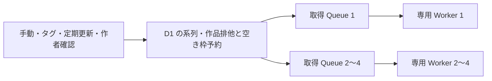
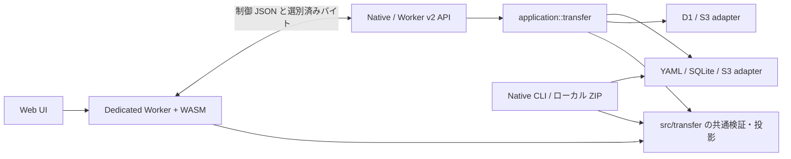

# v0.5.0 新機能アーキテクチャ

対象: 非表示設定 / サイト別並列ダウンロード / 小説データの ZIP 転送 / バーチャル小説。

## 0. 実装状況

| 機能 | Native CLI | Native Web UI | Native API | Worker API | ブラウザ WASM |
|---|---|---|---|---|---|
| 非表示設定 | `narou hidden`, `list --show-hidden` | トグル・右クリック・非表示設定モーダル | `GET/POST /api/hidden` | 同左 | — |
| サイト別並列DL | `narou update` ファミリー並列 | update + 個別DL（family 排他） | — | Queue `max_concurrency=4` + D1 admission | — |
| ZIP 転送 | `narou export/import` | サーバー ZIP 版。クライアント WASM 未接続 | `GET/POST /api/transfer/*` | 同左（ObjectStore、workerd 契約テスト済み） | 単体の build/parse/plan のみ。UI は未使用 |
| バーチャル小説 | `narou virtual`, `convert vs_<ID>` | 登録・追加・順序・属性・削除・EPUB | `/api/virtual_novels` | 同左、結合 EPUB・変換ジョブ | — |

転送の現状と再設計 (2026-11-15): Web UI への WASM 接続は未実装。[クライアント主体の転送設計](client-transfer-design.md) が今後の責務・HTTP・保存・配布・受入条件を定義する。本書の現行 API 説明と、未実装の新設計を混同しない。

---

## 1. 全体レイヤ

```
┌──────────────────────────── UI / entry ────────────────────────────┐
│ CLI (src/cli.rs, src/main.rs, src/commands/*)                      │
│ Native Web UI (src/web/assets/js) / HTTP (axum)                    │
│ Browser WASM (transfer_wasm)                                       │
│ Cloudflare Worker (worker_entry)                                   │
└───────────────┬───────────────────────────────┬────────────────────┘
                │                               │
┌───────────────▼──────────────┐  ┌─────────────▼────────────────────┐
│ application / domain         │  │ platform (traits)                │
│ hidden / downloader /        │  │ HttpClient, ObjectStore,         │
│ update grouping / transfer   │  │ NovelRepository, RateLimiter,    │
│ core (wasm-safe)             │  │ CookieStore, Clock               │
└───────────────┬──────────────┘  └─────────────┬────────────────────┘
                │                               │
┌───────────────▼───────────────────────────────▼────────────────────┐
│ native adapters                    │ Worker adapters               │
│ SQLite / FS / curl・reqwest        │ D1 / ObjectStore / fetch      │
└────────────────────────────────────┴───────────────────────────────┘
```

設計原則:

- **表示・転送・取得の共通ロジックはプラットフォーム非依存**。Native と Worker はアダプタだけを差し替える。
- **保存形式は 1 箇所**。非表示は在庫 `hidden`、サイトファミリーは `platform::site_family`、アーカイブは `src/transfer`。
- **書き込みは ObjectStore 経由**。Native の FS・SQLite、Worker の D1・S3 で同じ転送コードを使う。

---

## 2. 非表示設定

### 2.1 データモデル

```rust
pub struct HiddenState {
    pub novels: BTreeSet<i64>,     // 作品 ID
    pub tags: BTreeSet<String>,    // タグ名
    pub authors: BTreeSet<String>, // 表示上の作者名 (比較時 fold)
    pub sites: BTreeSet<String>,   // domain / sitename (比較時 fold)
}
```

- タグ非表示は **そのタグを持つ作品も一覧から除外**する。
- 作者・サイトは `fold` した値で比較する（大文字小文字・全半角の表記差を吸収）。
- 非表示は**表示だけ**に作用する。update / convert / clean / mail など内部列挙は対象のまま。

### 2.2 保存

| モード | 保存先 | 備考 |
|---|---|---|
| Native YAML | `.narou/hidden.yaml` | `Inventory` 管理。`db export-yaml` にも含まれる |
| Native SQLite | `app_state(scope='inv', key='hidden')` | `state_inventory::MANAGED_STATES` に登録 |
| Worker | D1 `app_state(scope='inv', key='hidden')` | `value_yaml` も書き、YAML 互換を維持 |

保存経路:

```
CLI hidden / Web UI / Worker API
        │
        ▼
HiddenState の add/remove/clear
        │
        ├─ Native: Inventory::update_yaml("hidden")  ← 同一ロックで read-modify-write
        │           ├ YAML モード: .narou/hidden.yaml
        │           └ SQLite モード: app_state
        └─ Worker: D1 app_state をスナップショット CAS で更新（同時更新は再試行）
```

### 2.3 一覧フィルタ

`NovelFilter` に表示専用の除外条件を追加:

```rust
pub struct NovelFilter {
    // ...
    pub exclude_ids: Vec<i64>,
    pub exclude_tags: Vec<String>,
    pub exclude_authors: Vec<String>, // fold 済み
    pub exclude_sites: Vec<String>,   // fold 済み
}
```

`HiddenState::apply_to_filter()` がこれらを埋める。

適用箇所:

```
表示用一覧 (Web /api/list, CLI list)
   │  include_hidden = show_hidden
   ▼
NovelFilter + hidden excludes
   ├─ Native SQLite: db/novel_query::build_where → SQL
   │     NOT IN (json_each(?)) / NOT EXISTS (novel_tags)
   ├─ Native YAML: platform::repository::record_matches_filter
   └─ D1 (Worker): 同じ novel_query SQL
```

`include_hidden=false` のときだけ除外を足すため、`NovelFilter::all()` を使う内部処理には影響しない。

### 2.4 インターフェース

- CLI: `narou hidden add/remove/list/clear`、`narou list --show-hidden`
- Native API: `GET /api/hidden` / `POST /api/hidden` (`action: add|remove|clear`, `novels/tags/authors/sites`)
- Worker API: 同形（D1 実装）
- Web UI:
  - 一覧ツールバー「非表示も表示」トグル（`show_hidden=true`）
  - 作品行の右クリック「非表示 / 表示に戻す」
  - オプション →「非表示設定...」モーダルで作品 ID・タグ・作者・サイトを追加/解除

---

## 3. サイト別並列ダウンロード

### 3.1 サイトファミリー

同一運営のホストを 1 つの系列として扱う。

```
syosetu.com
  ├ ncode.syosetu.com       (一般)
  ├ novel18.syosetu.com     (R18)
  ├ xmypage.syosetu.com     (作者ページ)
  └ api.syosetu.com
pixiv.net
  ├ www.pixiv.net
  └ accounts.pixiv.net
その他: 登録可能ドメイン相当（最後の 2〜3 ラベル）
```

共通関数 `narou_rs::platform::site_family(domain)` が自動判定を担い、サイト定義の
`site_family:` が指定されていればそちらを優先する（`SiteSetting::download_site_family()`）。
`co.jp` などの 2 段階 suffix も考慮する。

```yaml
# webnovel/ncode.syosetu.com.yaml
domain: ncode.syosetu.com
site_family: syosetu.com

# webnovel/novel18.syosetu.com.yaml
domain: novel18.syosetu.com
site_family: syosetu.com

# webnovel/www.pixiv.net.yaml
domain: www.pixiv.net
site_family: pixiv.net
```

新しいサイトや別ドメインの作者ページを同じ系列にしたい場合は、コードを変更せず
`site_family` をユーザーの `webnovel/*.yaml` に書けばよい。未指定のサイトだけ
ドメインから自動判定する。

### 3.2 Native `narou update`

```
target IDs
   │ domain 解決 (record.domain)
   ▼
build_domain_groups()  ← site_family で集約
   │ [(family, [ids...]), ...]
   ▼
max_parallel_domains 個の worker
   │ 各 worker は family を 1 つずつ取り、family 内を直列処理
   ▼
process_novel_for_update()
   ├ 小説ロック (NovelLockGuard)
   ├ レートリミッタ (サイト定義 domain)
   └ family 単位の開始間隔
```

- なろう系 3 ドメインは同一 family なので **直列**。
- カクヨムと Pixiv は別 family なので **並列**。
- 設定 `update.max-parallel-domains`（既定 4）で worker 数を制御。

### 3.3 Worker Queue

取得用 Queue を4つの独立した Worker script に分離する。同じ Wasm 成果物を
`NAROU_WORKER_ROLE=acquisition` / `NAROU_ACQUISITION_LANE=0..3` で配備し、
各 script は自分の Queue だけを batch 1 / concurrency 1 で消費する。
管理 Worker の旧 Queue は保存済み配信の取り込み専用で、そこで取得は実行しない。



- 実効 YAML から `site_key` と `normalized_target` を待機前に保存する。
- `worker_acquisition_lanes` の4行が配信予約を持つ。固定ハッシュではなく、
  最も古い実行可能な系列を空きレーンへ割り当てる。同一系列の予約は1つまで。
- v3 envelope は job ID・lane・dispatch token だけを運ぶ。台帳の予約と一致する
  配信だけが claim でき、古い配信は新しい所有者の実行・枠解放をできない。
- 同じ作品の変換も、取得の配信予約・実行リースと排他する。途中キャンセルは
  実処理が止まるまで所有権を保持し、異常終了は期限後に回復予算付きで回収する。
- まだ claim していない予約は、待機取消と同じトランザクションで解放する。
  取消済みメッセージが失われたり DLQ に入ったりしても系列を塞いだままにしない。
- 本文処理・Downloader・メモリ枠を解放してから次を配送する。各 isolate の
  重い処理は引き続き1件で、EPUB 配信側のメモリ枠とは共有しない。
- cron は計画・回収を終えてメモリ枠を解放してから変換を起こす。計画が失敗した
  場合も再配信を行い、cron 中に容量待ちへ戻された変換を取り残さない。
- サイト定義が配信予約後に変わった場合は取得前に再分類し、系列情報の更新と
  古い予約の解放を同じ D1 batch で行う。
- サイトごとのリクエスト間隔は既存の `SiteRateLimiter` Durable Object が守る。

手動配備も migration `0020_acquisition_lanes.sql` → 取得専用 Worker →
管理 Worker → 配信 Worker の順にする。旧 Queue / DLQ / 資格情報は削除しない。
初回の CI 配備では共有 DO の所有者が無いため、同じ成果物の管理 Worker を
非公開・consumer / cron 無しで先に作る。既存の管理 Worker はこの bootstrap で
変更しない。所有者が揃ってから取得レーンを配備し、最後に通常の管理・配信へ切り替える。
ローカルは `worker_entry` で以下を起動する。

```sh
npx wrangler dev -c wrangler.toml \
  -c wrangler.acquire-1.local.toml -c wrangler.acquire-2.local.toml \
  -c wrangler.acquire-3.local.toml -c wrangler.acquire-4.local.toml
```

### 3.4 Native Web UI の個別DL

Native Web のキュー worker は Default lane に複数 worker を置き、`running_jobs` から
実行中のサイトファミリーを計算して、同じ family のジョブを pop 対象から除外する。
異なる family（カクヨムと Pixiv など）は同時に実行され、なろう系は 1 本に直列化される。
小説単位のロック (`lock.yaml`) も従来どおり併用する。

---

## 4. 小説データの ZIP 転送

### 4.1 アーカイブ形式

```
manifest.json
novels/0/toc.yaml
novels/0/本文/....
novels/0/setting.ini
novels/0/挿絵/....
novels/1/...
```

`manifest.json`:

```json
{
  "format_version": 1,
  "app_version": "0.5.0",
  "exported_at": "...",
  "novels": [
    {
      "toc_url": "https://...",
      "title": "...", "author": "...",
      "sitename": "...", "domain": "...",
      "tags": [], "novel_type": 1,
      "ncode": "...", "subtitle": "...",
      "general_lastup": "...", "last_update": "...",
      "files": [
        {"path": "toc.yaml", "size": 1234, "sha256": "..."}
      ]
    }
  ]
}
```

決定性:

- 作品は `(toc_url, title)`、ファイルは `path` でソート
- ZIP のタイムスタンプは固定、Deflate は pure Rust の zlib-rs
- 同じ入力から同じバイト列

### 4.2 共通コア `src/transfer`

> **書式の詳細 (manifest のスキーマ・検証ルール・衝突規則・同梱対象・挿絵の扱い) は
> [`docs/transfer-archive-format.md`](transfer-archive-format.md)** にまとめています。

```
build_archive(&ArchiveManifest) -> Vec<u8>
parse_archive(&[u8]) -> ParsedArchive
plan_import(&ParsedArchive, &[ExistingNovel], ConflictPolicy) -> ImportPlan
```

検証:

- アーカイブ / エントリ / 作品数 / manifest のサイズ上限
- パストラバーサル、絶対パス、ドライブレター、`\`、NUL、制御文字、末尾ドット/空白
- Windows 予約名、大文字小文字を畳んだ重複、ファイル/ディレクトリ衝突
- symlink・暗号化エントリ
- manifest と ZIP エントリの完全一致、サイズ・SHA-256
- zip bomb 対策として展開を `take` で上限付き読み出し

`plan_import` は純粋関数。`toc_url` の完全一致で既存作品を判定し、`Create` / `Overwrite` / `Skip` を返す。

### 4.3 入口と v0.6.7 の転送経路

v0.6.7 は実装・統合検証中。公開済み v0.6.6 のサーバー ZIP 経路とは区別する。受入条件と検証限界は [client-transfer-design.md](client-transfer-design.md) に置く。



#### Native CLI

- `narou export <target>... [-o file.zip]` / `narou import <file.zip> [--overwrite|--skip]` はローカル ZIP を扱う。Web の ZIP HTTP API は使わない。
- DB-only・S3 を含む保存内容を専用 private snapshot から逐次書き出し、通常処理の canonical 保存先へ一時復元しない。
- ZIP64 の索引・各 entry のサイズ・CRC・SHA-256 を検証してから取り込み計画を確定する。
- Create は正規の ID 予約と元の操作ガードを保持し、保存が成功してからレコードを公開する。Overwrite は既存 ID / フォルダを維持し、アーカイブに含まれるファイルだけを置換する。
- YAML・SQLite・S3 の保存方式は Native adapter が選ぶ。CLI のミラー無効構成と Web v2 の参照公開は別経路として検証する。

#### Native / Worker Web API

- `GET /api/transfer/v2/capabilities` で保存先の制約・投影ポリシー・配布 codec を交渉する。
- `/api/transfer/v2/imports` / `exports` の session、manifest、ファイルチャンク、制御 API を使う。サーバーは ZIP を受信・生成せず、選別済みのバイト・ハッシュ・受領記録を扱う。
- 1 HTTP バイナリ本文はフレーム込み 8 MiB / 100 レコード以下。総ファイルサイズの制限とメタデータ保持予算は分ける。
- 保存・公開・キャンセル・回復は `application::transfer` を共有し、元の epoch と永続 journal を使う。公開済み作品を後続の中断で巻き戻さない。
- 既存の認証・CSRF 境界を維持する。旧サーバー ZIP route と Base64 data frame へのフォールバックは設けない。

#### Browser WASM

- `transfer_wasm` を Dedicated Worker で実行する。配布 manifest のハッシュ・protocol / ABI / build ID を確認できなければ開始しない。
- ZIP64 の索引・パス・重複・選択 entry のサイズ・CRC・SHA-256 をクライアントで検証し、選別した entry だけを逐次展開する。
- 既定 `runtime` は raw・本文履歴・確認済み派生物を通信前に除外する。目次・本文・設定・挿絵・未知の利用者ファイルを保持する。Worker は raw を新規保存しない。
- ZIP の生成もクライアントが担当する。64 KiB 以下の codec I/O と保存先の backpressure を接続し、全 ZIP / 全展開ファイルを `Vec`・`String`・Base64 JSON にまとめない。
- WASM 単体のテストだけでは Web UI の完了とみなさない。配布 artifact を使う実ブラウザと、制限付き HTTP gateway・実バックエンドでの往復を確認する。

### 4.4 競合と保全

- 既定は `Skip`。CLI の `--overwrite`、Web v2 session の `conflict_policy: overwrite` で `Overwrite`。
- 同一 ZIP 内に同じ `toc_url` が複数あるのはエラー。
- Overwrite は**アーカイブにあるファイルだけ**を置換し、削除はしない。古いアーカイブで現在の本文・新しい話・変換履歴を失わない。
- Create は新しい ID を採番し、`file_title` を再計算する（アーカイブにフォルダ名は含めない）。
- ログイン資格情報やライブラリ全体の管理 DB は転送しない。`runtime` / `complete` のファイル選別とメタデータ収録項目は [transfer-archive-format.md](transfer-archive-format.md) に従う。

---

## バーチャル小説

- `src/virtual_novel.rs` が所属の検証と `MemberSummary`（タグ・話数・最新話掲載日・属性）の共通契約を持つ。属性は表示設定と独立し、混在時の選択を保持する。
- `src/application/virtual_book.rs` がメンバー順の本文・章見出し・挿絵参照を結合する。画像はメンバー ID を含む別名で区別し、実体は元作品の ObjectKey から読む。Native と Worker は同じ変換処理へ結合済みの入力と仮想小説自身の設定を渡す。
- メンバーのメタデータは最大 90 ID ごとの一括取得を使い、話・画像ごとに作品を読み直さない。EPUB はメンバー変更を反映するため要求ごとに生成し、更新確認用の定期ポーリングは追加しない。
- 一覧も同じモジュールの `list_entries` を使う。Native は DB ロック内のレコードを借用し、Worker は `load_listing` で親・メンバー ID を重複除去して最大 90 ID ずつ取得する。メンバー順と欠落位置を保ち、欠落・不正な構成では保存済みの属性を維持する。Worker の複数ページを横断するトランザクションスナップショットを保証するものではない。
- 更新対象の親作品判定は `virtual_novel::is_virtual_record` に集約する。通常タグや所属マップの有無ではなく `ncode=vs_<数字>` で判定し、メンバーは通常どおり更新する。Worker は更新の投入時と実行時の両方で親を除外し、古いキューの親更新も成功として終了する。実作品の実行前メタデータはサイト admission・凍結表示・開始間隔で共用し、キャンセル確認とチェックポイント検証の順序は変えない。

### 所属変更の保存境界

- Native SQLite は `Database::update_virtual_records` で作品・所属・タグ連番を同一トランザクションに入れる。Native YAML はタグ連番 → 所属 → 作品の順でファイルロックを取り、ロック内の最新状態へ操作を適用する。
- YAML の公開後に書き込みが失敗した場合は、変更済みファイルを元へ戻す。通常の `Database::save` も同じ復元処理を使い、rename 成功後の同期エラーを含めて扱う。復元も失敗した場合は対象パスと原因をエラーに含め、成功扱いしない。SQLite の `narou-compat` 投影も COMMIT 失敗時に戻す。互換ファイルが欠けた場合は SQL の保存状態を保持し、明示的に空にしたファイルとは区別する。ただし、複数 YAML の公開中のプロセス強制終了・電源断に対するクラッシュ原子性は保証しない。
- Worker は操作（登録・追加・並べ替え・削除）を最新スナップショットへ適用し、所属の CAS と作品・タグ・タグ連番の変更を同じ D1 batch に入れる。CAS が書き込まなければ guard が batch 全体を中断する。競合時に古い完成済みマップを書き戻さない。
- 追加時は現在の親作品のタグ・属性とメンバーの分類を UPDATE 条件で照合し、無関係なタイトル等の更新や混在時の選択を上書きしない。分類が変わっていれば primary から集計し直す（成功時の SQL 発行数は増やさない）。削除と追加の競合で削除済みの親を復活させず、実メンバーの作品は削除しない。
- 壊れた所属データは空の構成へ置き換えず、CLI は失敗終了、一覧 API は Native／Worker とも HTTP 503 を返す。

### 一覧取得と SQL コスト

- `application::library::list_records` は Native／Worker／外部 API の共通経路。開始位置 0・上限なしなら取得したレコード数を絞り込み後件数に使い、無条件の取得では総件数にも使う。部分取得では必要な COUNT を残す。空の ID 指定は「無条件」と同一視しない。
- Worker のタグ列挙は `novel_tags` の既存の被覆索引を使う。親の存在は外部キーと削除時の CASCADE が保証するので、タグを読むたびに親作品を読み直さない。色設定の正規形式が既にあり、変更も旧形式の残存もなければ書き込まない。旧形式の移行と CAS は省かない。
- ローカル workerd／Wrangler 4.151.3 で実際の D1 応答の `meta.rows_read` / `rows_written`、SQL 発行数、D1 呼出往復数を計測した。2,450作品（実作品2,400件、仮想小説50組×4メンバー）、タグ行5,100件、終了済みジョブ41,650件の合成データ。初回移行を終え、同じ経路をウォームアップした比較である。7経路の JSON 応答全体が変更前と一致した。**SQL 文数・D1 往復数・課金対象の読み取り行数は別々に見る**。batch は複数の SQL を1往復で送るが、各文の読み取りを消すものではない。

| 経路 | D1 往復（前 → 後） | SQL 数（前 → 後） | 読み取り行数（前 → 後） | 書き込み行数（前 → 後） |
|---|---:|---:|---:|---:|
| 全件一覧（メンバー200件を表示から除外） | 7 → 6 | 7 → 6 | 13,554 → 8,454 | 0 → 0 |
| 部分一覧（開始5・10件） | 7 → 7 | 7 → 7 | 9,084 → 9,084 | 0 → 0 |
| タグ条件付き全件一覧 | 7 → 6 | 7 → 6 | 15,554 → 9,454 | 0 → 0 |
| タグ一覧 | 6 → 5 | 7 → 5 | 11,179 → 6,075 | 1 → 0 |
| 仮想小説一覧（50組） | 307 → 9 | 307 → 9 | 2,858 → 1,906 | 0 → 0 |
| キュー件数 | 1 → 1 | 2 → 2 | 5 → 5 | 0 → 0 |
| キュー詳細一覧 | 1 → 1 | 2 → 2 | 8 → 8 | 0 → 0 |

これは本番 D1 の課金明細の再現ではなく、SQL の VM 命令数を読み取り行数に換算した値でもない。初回移行、キャッシュの冷暖、同時書き込み、ページ数で費用は変わる。キャッシュ期間・定期ポーリング頻度は延ばさず、変更の反映を遅らせない範囲で重複処理を省いている。

### 更新処理と17日間の負荷モデル

- 全更新の投入は、実際の台帳・キュー送信を動かし、配信だけを検証用ラッパーで保留して測った。仮想の親50件を除く修正で、対象は2,450件から2,400件、D1 往復は64→62回、SQL は2,489→2,438文、読み取りは40,732→38,177行、書き込みは14,700→14,400行になった。これは**投入だけ**の費用で、実行費用を含まない。
- 100話・掲載日時が変わらない作品を実際に更新すると、上流取得は目次1回・本文0回。実行時の SQL は159→158文、読み取りは1,302→1,301行で、作品メタデータの主キー検索を1回省いた。最終実装の D1 往復は139回。別途、個別投入の20 SQL／20往復／933行が掛かる。**実行中かを確かめる102回・102行のキャンセル確認は残した**。これを無条件に間引いて、取消後の取得・保存や後続変換を許す最適化はしない。
- 仕事がない定期 tick は、実測で9〜10 SQL／9〜10往復／913〜914行だった。キャッシュ状態による差を改善率に数えない。この構成ではうち902行が作品属性の整合処理であり、キュー履歴41,650件の全走査ではない。

次は実測単価へ明示的な回数を掛けた**仮定モデル**で、本番の17.77B読み取りを再現・説明した値ではない。実行、ブラウザ表示、cron は別の負荷なので、同一視しない。

| 仮定する負荷 | 17日間の回数 | 修正後の読み取り行数 |
|---|---:|---:|
| 1タブを常時開き、既定600秒ごとに一覧＋キューを取得 | 2,448 | 20,707,632 |
| 毎分の idle cron | 24,480 | 22,350,240〜22,374,720 |
| 毎日1回、2,400実作品を更新。全作品が上記100話・差分なし条件 | 17回の投入＋40,800実行 | 53,729,809 |
| 各作品の終了で一覧＋タグ＋キューを1セット取得する表示モデル | 40,800 | 592,987,200 |

最後の表示モデルは変更前だと1,009,310,400行になる。実際は50ms単位の通知集約、開いているタブ数、更新頻度、追加の変換、キャンセル・再試行、話数、初回移行などで変わる。これらを単純に足して請求額とはしない。本番原因の特定には、期間・実行版・クエリ別実行回数と `rows_read`・ブラウザの再取得頻度を対応させた計測が必要である。

### 鮮度を維持する設計判断

- 既定の `webui.table.reload-timing=every`、600秒の定期表示更新、設定のキャッシュ期間は変えない。ユーザー操作・再接続の反映を遅らせて issue #46 の症状を隠さない。
- 既存の `webui.table.reload-timing=queue` は利用者が選べる容量優先の設定である。ジョブごとの一覧・タグ更新をキュー終了までまとめる代わりに、途中の変化は定期更新や手動再取得まで遅れる。キュー件数・進捗通知は別に更新する。実 workerd で `every` / `queue` の終端通知を確認した。既定値を一律に変更する方針は取らない。
- 次の設計候補は、毎回の属性再計算を「関係する作品・所属が変わったとき」に限ること。ただし単なる TTL 延長ではなく、作品・所属・分類と同じトランザクションで世代または dirty 状態を進め、取得・転送・分類変更・削除・旧データ移行の全書き込み経路を覆う必要がある。競合と再開時の欠落を実証できるまでは導入しない。
- 変更のない話の走査でも現在はキャンセル確認が発生する。差分計画と取得・保存前の確認を分離する設計は候補になるが、改題・挿絵の自己修復・予算切れの継続を含む全副作用の境界を先に証明する。安全性と取消応答を測らずに確認回数だけ削減しない。

---

## 5. セキュリティ境界

| 対象 | 対策 |
|---|---|
| ZIP | パス検証、サイズ/エントリ上限、zip bomb 防止、SHA-256、manifest 完全一致 |
| 非表示 API | 既存の Web 認証ミドルウェア配下。入力は ID/文字列のみ |
| Worker admission | site_key はサーバー側で解決（クライアント指定なし）。同一 family を D1 で排他 |
| 転送 import | 書込みは ObjectStore 経由。`sqlite.mirror-files=false` は fail closed |
| ブラウザ WASM | コアのみ。DOM/ネットワーク/FS に触れない |

---

## 6. テスト方針

- 非表示: `HiddenState` 単体、SQL 除外条件、`LibraryService::list` の表示フィルタ
- 並列: `site_family` 単体、`build_domain_groups` のファミリー集約、Worker admission の site_key
- 転送: コア 24 本（roundtrip / traversal / 重複 / 上限 / plan）、Native CLI の YAML・SQLite E2E、Web API smoke、WASM roundtrip
- バーチャル小説: Native CLI の保存・削除失敗、SQLite COMMIT 失敗時の互換 YAML 復元、実 workerd の同時登録・追加・順序変更・削除と D1 batch ロールバック、同名画像を含む Native／Worker の実 EPUB
- CI: `cargo test --workspace` / clippy / JS 回帰テスト / wasm check / Worker contract

---

## 7. 残課題

1. Native Web UI の個別 Download 同時実行（異 family 並列、同一 family 直列）
2. ブラウザ UI のクライアント WASM 転送。[再設計](client-transfer-design.md) の全受入条件を満たすまで未完了（現状はサーバー ZIP API）。
3. Worker 転送 API の workerd 契約テストと CI 統合
4. 0.5.0 リリース（develop 統合・タグ・Release）
